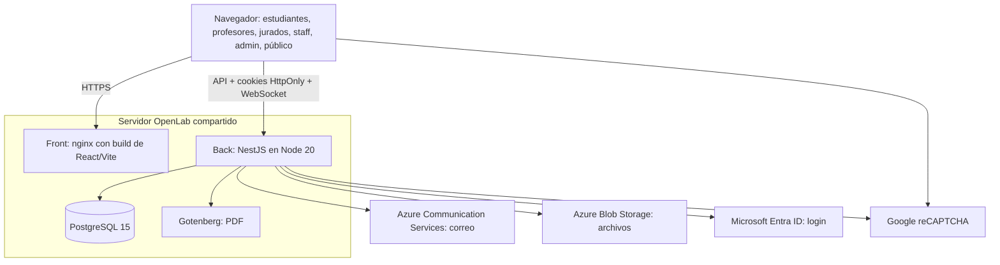
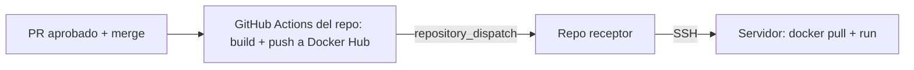

# Arquitectura general

> **Audiencia:** todos · **Actualizado:** 2026-11-05 · **Estado:** completo a nivel general · **Fuente:** [pipeline](../04-devops/pipeline-y-despliegue.md), [backend](../02-backend/README.md), [frontend](../03-frontend/README.md)

## Componentes

- **Front** (`gamerlab_front_2295_2`): SPA React 19; se sirve con nginx. Habla con el back por HTTP (`VITE_ENDPOINT_BACKEND`) y Socket.IO.
- **Back** (`gamerlab_back_2295_2`): API REST NestJS, Prisma sobre PostgreSQL, JWT en cookies HttpOnly, Socket.IO para likes y seguimiento.
- **Ambientes:** *test* (`dev` / `dev-deploy`) y *producción* (`main`), cada uno con su contenedor de API, de front y de base de datos, en un servidor compartido con ~15 proyectos más.
- **Docker Hub** guarda las imágenes (un solo repositorio para todo).

## Del código a producción

Detalle y contenedores/puertos: [04-devops/pipeline-y-despliegue](../04-devops/pipeline-y-despliegue.md).

## Datos
PostgreSQL con migraciones Prisma. La cuenta de usuario es global; la inscripción, jurados, calificación y contenido son **por edición**. Histórico (V1/V2) en tablas `*_historico`. [Modelo de datos](../02-backend/modelo-de-datos.md).

## Seguridad en una línea
Toda ruta del back exige sesión salvo `@Public()`; permisos por rol y servicio; límites de peticiones en rutas públicas; secretos solo en el `.env` del servidor y en GitHub Secrets. [Auth](../02-backend/auth-y-sesiones.md), [accesos](../04-devops/variables-y-accesos.md).

## Dónde vive cada cosa
| Qué | Dónde |
|---|---|
| Código back / front | GitHub `djromerom/gamerlab_back_2295_2` / `gamerlab_front_2295_2` |
| Receptores de despliegue | repo openlab del back y `openlabun/Arkad-Front` |
| Imágenes | Docker Hub `openlabarkad/openlabarkad-test` (incluye producción) |
| Servidor | Servidor OpenLab (acceso SSH; los datos de acceso se entregan por canal privado, no están en el repo) |
| Backlog y tickets | Jira, proyecto ARK + `ARKAD_v4_plan_y_backlog.md` |
