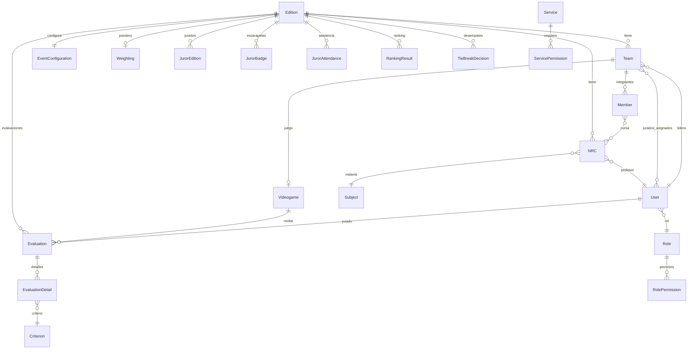

# Modelo de datos

> **Audiencia:** Backend, DevOps · **Actualizado:** 2026-11-07 · **Estado:** completo para `schema.prisma` de la rama leída (ver nota en el [README](README.md)) · **Fuente:** `back/prisma/schema.prisma`

Convención: modelo en inglés, tabla/columnas en español vía `@map`. Borrado lógico con `isActive`. `schema.prisma` es la fuente de verdad: no editar migraciones ya mergeadas.

## Diagrama (simplificado)

## Grupos de tablas

| Grupo | Modelos (tabla) | Notas |
|---|---|---|
| **Edición y configuración** | `Edition` (`ediciones`), `EventConfiguration` (`configuracion_evento`), `Weighting` (`ponderado`) | `Edition`: `@@unique([year, semester])`, estado `EditionStatus` (ACTIVE/INACTIVE/ARCHIVED), semestre 10/20/30. `EventConfiguration`: `evaluationsOpen`, `showEvaluations`, `showRanking`, `registrationsOpen`, `showFinalGrade` y `finalGradeReleasedAt` (HU-20), una por edición. `Weighting`: `seniorPct`/`juniorPct` por edición |
| **Acceso** | `User` (`usuarios`), `Role` (`roles`), `Service` (`servicio`), `Permission` (`permisos`), `RolePermission`, `ServicePermission`, `ConfirmationStatus`, `TokenType`, `VerificationToken`, `RefreshToken` | `User`: `jurorCategory` (JUNIOR/SENIOR), `jurorType` (OFFICIAL/BACKUP), `authMethod`, `microsoftOid`. La cuenta es **global** |
| **Equipos** | `Team` (`equipos`), `Member` (`integrante`), `TeamVerification`, `TeamVerificationLog` | `Team` únicos por edición: `(teamCode, editionId)`, `(verificationCode, editionId)`, `(userId, editionId)`, `(teamName, editionId)`. `Member` únicos por edición: `(email, editionId)`, `(studentCode, editionId)`; `editionId` se copia del equipo. `verificationCode` es null en N0 |
| **Videojuegos** | `Videogame`, `VideogameStatus`, `VideogameLike`, `HighlightedGame`, `Upload` | Un videojuego por equipo (`teamId` único). Estado por defecto id 2. `Upload.isPublic` por defecto `false` (BG-24) |
| **Académico** | `Subject` (`materia`), `NRC` (`nrc`), `Criterion` (`criterios`) | `NRC` pertenece a edición, materia y profesor (`User`) |
| **Evaluación** | `Evaluation`, `EvaluationDetail` (`detalle_evaluacion`), `EvaluationIdempotency`, `RankingResult` (`resultado_ranking`), `TieBreakDecision` (`decision_desempate`), vista `TeamFinalScore` (`vw_team_final_scores`) | `Evaluation`: único `(jurorId, videogameId)`, `isSenior`, `contentHash`, `idempotencyKey`. `RankingResult` con `level` (N0–N4) y `finalPosition` por nivel. `TieBreakDecision.tieKey` identifica el empate (edición, nivel, nota, equipos): si cambian las notas, la decisión deja de aplicar |
| **Jurados** | `JurorEdition` (`jurado_edicion`), `JurorBadge` (`escarapelas_jurado`), `JurorAttendance` (`asistencia_jurado`), `JurorAssignmentAuditLog`, `SubstituteNotice` (`aviso_suplente`), `SubstituteNoticeTeam` (`aviso_suplente_equipo`) | `JurorEdition`: estado PENDING/CONFIRMED/DECLINED y tipo por edición; los profesores **no** tienen fila (son jurados si tienen NRC activo). `alta_dia_feria` (`walkIn`, HU-24) marca al jurado que el administrador dio de alta el día de la feria; `GET /juror-edition` lo devuelve. Asignación equipo↔jurado: relación implícita `Team.assignedJurors` (`JurorTeamAssignment`). Índices únicos parciales de escarapela y asistencia están **a mano en la migración** (Prisma no los expresa). `SubstituteNotice` (HU-22, ARK-84): aviso «Te asignaron grupos» a un suplente, uno por operación de asignación; `leido_en` null = sin leer; `estado_correo` PENDING/SENT/FAILED/SKIPPED y `error_correo` (motivo corto, sin datos personales). `SubstituteNoticeTeam` guarda una foto del código, nombre, videojuego y nivel de cada grupo; si el equipo se elimina, `id_equipo` queda en null. `JurorAttendance` (BG-49, ARK-251): una llegada anulada queda con `activo = false`, `anulado_en`, `anulado_por` (usuario, FK a `usuarios`) y `motivo_anulacion` (opcional, máx. 500); todas las consultas leen solo las activas y el índice único parcial (solo activas) deja registrar la llegada otra vez (migración `20261119000000_add_juror_arrival_annulment`) |
| **Landing** | `EducationalFocus`, `Testimonial`, `HighlightedGame` (`juego_destacado`) | Por edición. `HighlightedGame` (HU-41, ARK-229) apunta a un videojuego en vivo (`id_videojuego`) **o** a uno histórico (`id_videojuego_historico`): el CHECK `juego_destacado_un_videojuego_check` (solo en la migración) exige exactamente uno. Únicos `(edición, videojuego)` y `(edición, videojuego histórico)`; borrar el histórico borra su destacado (`ON DELETE CASCADE`) |
| **Histórico** | `HistoricalTeam`, `HistoricalMember`, `HistoricalMemberNrc`, `HistoricalVideogame` | `HistoricalMemberNrc` es una foto inmutable sin llave foránea al NRC vivo. El histórico trae `likes` y `finalScore` |

## Cosas que sorprenden
- **Global vs por edición:** ver `docs/editions.md` (qué es global: cuentas, catálogos, archivos; por edición: inscripción, jurados, calificación, contenido).
- La nota final **no se guarda** en una tabla: se calcula en la vista `vw_team_final_scores` (avg junior, avg senior, final, cuántas evaluaciones cuentan y si hay ponderación). `RankingResult` guarda el resultado del ranking cuando se finaliza.
- El rol `Administrador` se reconoce por nombre; los permisos por `Service`+`Permission`.
- Índices únicos parciales (escarapelas activas, asistencia activa, NRC `(codigo, id_edicion) WHERE activo`) y el CHECK de `juego_destacado` existen solo en SQL de migraciones: si regeneras el esquema con `migrate dev` no se reflejan en `schema.prisma`.
- La tabla de podio se eliminó en mayo de 2026.

## Históricos legados (V1/V2)
Tablas `equipos_historico`, `integrante_historico`, `videojuegos_historico` (197/723/197 tras consolidar). Ver [04-devops/base-de-datos-operacion](../04-devops/base-de-datos-operacion.md).
