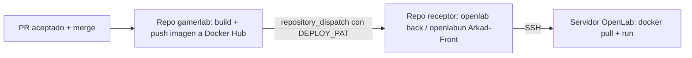

# Pipeline y despliegue

> **Audiencia:** DevOps, Backend, Frontend · **Actualizado:** 2026-11-05 · **Estado:** completo (según la entrega de Santiago, a 23-oct con ajustes posteriores) · **Fuente:** `contexto-devops-arkad.md` §3–§4 · Sin secretos ni hosts.

## Flujo real

Dos repos distintos intervienen: el **de origen** (`gamerlab_*`), que construye y publica la imagen, y el **receptor** (copia en la organización openlab), que se conecta por SSH al servidor. El código del receptor no se usa para desplegar; solo sus workflows.

## 1. Workflows de origen (back y front)
- **Trigger:** `push` a `dev`/`main` (back) o `dev-deploy`/`main` (front), más `workflow_dispatch` con `target_branch`.
- **Tag de imagen:** `sha-<7 del commit>-<sufijo>`; el sufijo sale del secreto JSON `BRANCH_IMAGE_TAGS`.
- Publica en Docker Hub y envía `repository_dispatch` (`peter-evans/repository-dispatch@v4`, payload `{ "tag": "..." }`):
  - rama de test → evento `test-image-published`
  - `main` → evento `prod-image-published`
- **Front:** `dev-deploy` usa `./Dockerfile` y el backend de test; `main` usa `./Dockerfile.prod` y el backend de producción. Las `VITE_*` se hornean en la imagen al construir.
- **`DEPLOY_PAT` y `REPO_DISPATCH_TARGET` son secretos por repositorio:** hay que cargarlos en back **y** front.
- **CI en PR** (`Test-back` / `Test-front`): back corre build, lint (`continue-on-error`), `npm run test:ci` y un job de integración contra Postgres 15 efímero (migrate, seed, e2e y `*.db.spec.ts`). El de front (`origin/main`, 2026-11-05) corre `check:env` (aviso), `npm ci`, `npm run build` (bloqueante), `eslint` (aviso) y `npm run test:ci` con Vitest (**bloqueante**); ya no es un placeholder.

## 2. Receptores

| Repo receptor | Archivo | Función |
|---|---|---|
| Back (copia openlab) | `test-deploy.yml` (`Test_deploy_back`) | Escucha `test-image-published`. SSH, carpeta `Arkad-api-test`, contenedor `arkad-app-test` |
| Back | `prod-deploy.yml` (`Prod_deploy_back`) | Escucha `prod-image-published`. Carpeta `Arkad-api-prod`, contenedor `arkad-api` |
| Back | `main.yml` (`Deploy_back`) | **LEGADO (Supabase). Peligroso**, ver [riesgos P0](riesgos-y-deuda.md) |
| Front (`openlabun/Arkad-Front`) | `test-deploy.yml` (`Deploy-dev-front`) | Contenedor `arkad-test` |
| Front | `prod-deploy.yml` (`Deploy-prod-front`) | Contenedor `arkad` (aquí prod **sí** usa `PASSPHRASE`) |
| Front | `main.yml` (`Deploy`) | **LEGADO.** Detiene un contenedor `arkadn` (puerto 5035) no documentado |

`openlabun/Arkad-Front` es un fork privado muy desactualizado del front original. > A CONFIRMAR: quién lo administra.

## 3. Imágenes, contenedores y puertos
Todas las imágenes (back/front, test/prod) están en **un solo repo de Docker Hub**: `openlabarkad/openlabarkad-test` (se llama «test» pero contiene producción).

| Servicio | Sufijo de tag | Contenedor | Puerto host → contenedor |
|---|---|---|---|
| Back test | `api_dev` | `arkad-app-test` | 5038 → 3000 |
| Back prod | `api_prod` | `arkad-api` | 5039 → 3000 |
| Front test | `frontend_dev` | `arkad-test` | 5037 → 80 |
| Front prod | `frontend_prod` | `arkad` | 5041 → 80 |

Otros contenedores: `arkad_gotenberg` (3005 → 3000); bases `arkad_db` (test) y `arkad_db_prod` (prod), `postgres:15-alpine`, **sin puerto publicado**. Redes: `arkad-shared`, `arkad-api-test_arkad-network`, `arkad-api-prod_arkad-prod-network`.

## 4. Servidor
- Servidor OpenLab compartido (Linux, SSH por llave). **Host y usuario no están aquí**: ver [variables y accesos](variables-y-accesos.md).
- Carpetas con el `.env` de cada ambiente: `/home/proyecto/Arkad-api-test` y `/home/proyecto/Arkad-api-prod`.
- **No usar `docker system prune`** ni consumir puertos/memoria sin mirar lo que ya corre.
- Los contenedores publican en `0.0.0.0`; si hay proxy en el mismo host, convendría `127.0.0.1` (> A CONFIRMAR con quien administra la red).
- `TRUST_PROXY=1` está definido en test y prod.

## 5. Entrypoint del back
`prisma generate` → `prisma migrate deploy` → seed (se salta si `NODE_ENV=production`) → app. **Corre sin `set -e`: si una migración falla, la app arranca igual.** Siempre revisar el log tras desplegar.

## 6. Cómo desplegar a mano (re-lanzar)
`Actions → Deploy-back / Deploy-front → Run workflow` con `target_branch` (`dev` o `dev-deploy` para test; `main` para prod). Debe pasar `docker-image` y luego `test-dispatch`/`prod-dispatch`, y el receptor debe correr. Si `docker-image` pasa pero el servidor no cambia: ver [incidentes](runbook-incidentes.md#deploy_pat).

## Referencias
- Fuente completa: entrega original de DevOps (fuera del repo).
- Diagrama heredado V3 (desactualizado): `arkad_docs/arkad_docs/docs/resources/Depoyment_Diagram.png`
